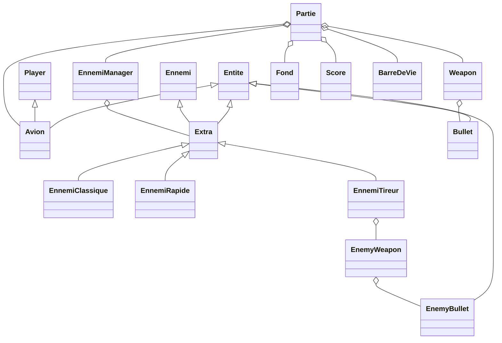

STRUCTURE ET DEROULEMENT DU JEU

Objets (classes) :

| Classe | Fichier | Role | Attributs | Methodes |
| --- | --- | --- | --- | --- |
| Entite | classes/entite.py | base commune a tout objet affiche | x, y, image, hitbox | afficher(screen) |
| Player | classes/player.py | base d'un joueur | x, y, speed, direction, vy, limite_droite | move(direction, dt) |
| Avion (Player + Entite) | classes/player.py | vaisseau du joueur | images (9 images) | changer_image(vies, direction) |
| Ennemi | classes/ennemi.py | deplacement d'un ennemi | x, y, speed, speed_down, limites, dh, dv | move(dt) |
| Extra (Ennemi + Entite) | classes/ennemi.py | ennemi affiche a l'ecran | image, hitbox | afficher(screen) |
| EnnemiClassique (Extra) | classes/ennemi.py | ennemi de base | vitesse 5 | — |
| EnnemiRapide (Extra) | classes/ennemi.py | ennemi rapide | vitesse 9 | — |
| EnnemiTireur (Extra) | classes/ennemi.py | ennemi qui tire | vitesse 2, weapon | update_tirs(dt, joueur) |
| EnnemiManager | classes/ennemi_manager.py | gere la flotte | ennemis, spawn_timer, images | update(dt, joueur, score), afficher(screen), verifier_collisions(joueur) |
| Bullet (Entite) | classes/arme.py | balle du joueur | speed 10, state | fire(x, y), update(dt), afficher(screen) |
| EnemyBullet (Entite) | classes/arme.py | balle ennemie dirigee | speed 4, direction_x, direction_y | update(dt), afficher(screen) |
| Weapon | classes/arme.py | arme du joueur | bullets, shoot_delay 600 ms | shoot_continuous(x, y), update(dt), afficher(screen) |
| EnemyWeapon | classes/arme.py | arme d'un ennemi | bullets, shoot_delay 5000 ms | shoot(x, y, player), update(dt), afficher(screen) |
| Fond | classes/fond.py | fond defilant | image, y1, y2 | update(dt), afficher(screen) |
| Score | classes/score.py | score et bonus | value, timer, bonus_timer, bonus_alpha | update(dt), ajouter_points(n), afficher(screen) |
| BarreDeVie | classes/barre_de_vie.py | vies du joueur | vies, max_vies, dimensions | perdre_vies(n), afficher(screen) |
| Sons | backend/audio.py | musique et bruitages | explosion, hit, game_over | stopper_musique() |
| Partie | backend/jeu.py | etat d'une partie | fond, joueur, score, barre_vie, weapons, ennemi_manager | appliquer_controles(), update(dt), dessiner(screen), gerer_collisions(), game_over() |

Relations :

- Entite est la classe mere de tout ce qui s'affiche (position, image, hitbox)
- Avion herite de Player (deplacement) ET de Entite (affichage)
- Extra herite de Ennemi (deplacement) ET de Entite (affichage)
- Les trois types d'ennemis heritent de Extra et changent vitesse / comportement
- Partie compose les objets du jeu ; Sons est cree a part dans main

Fichiers :

- main.py : demarrage + boucle de jeu
- backend/jeu.py : classe Partie
- backend/init.py : chargement des images, creation du joueur et des ennemis
- backend/physique.py : collisions balles-ennemis et ennemis-bas
- backend/controle.py : lecture du clavier
- backend/audio.py : classe Sons
- classes/ : les objets du jeu
- frontend/affichage.py : ecran de fin de partie
- config/config.py : toutes les constantes
- config/asset_paths.py : chemins des images et des sons

Constante :

- ecran : 1280 x 800, 60 images par seconde (REFERENCE_FRAME = 16.67 ms)
- joueur : 150 x 150 pixels, vitesse 8, 3 vies, invulnerabilite 1000 ms
- ennemi : 80 x 80 pixels, apparition toutes les 500 ms
    - classique vitesse 5, rapide vitesse 9, tireur vitesse 2
    - descente 1
- balle joueur : vitesse 10, 2 balles par tir, 1 tir toutes les 600 ms
- balle ennemie : vitesse 4, 1 tir toutes les 5000 ms, dirigee vers le joueur
- score : +1 toutes les 50 ms, +50 par ennemi detruit
- "+50" affiche pendant 1000 ms
- fond : defile de 2 pixels par image de reference
- game over : ecran affiche 3000 ms

Variable :

- dt (temps ecoule depuis la derniere image, en ms)
- direction du joueur (-1, 0, 1) et tir (vrai / faux)
- vies, score
- timers : spawn_timer, score_timer, bonus_timer, temps_invulnerable
- position du fond (y1, y2)
- listes : ennemis, bullets

Apparition des ennemis selon le score :

- moins de 2000 points : classique uniquement
- de 2000 a 5000 points : 70% classique, 30% rapide
- au-dela de 5000 points : 50% classique, 30% rapide, 20% tireur

Deroulement :

1. Demarrage
    - pygame.init() + creation de la fenetre
    - creation de Sons (la musique demarre)
    - creation de Partie (images chargees une seule fois, fond, joueur, score,
      barre de vie, arme, gestionnaire d'ennemis, 1er ennemi)

2. Boucle de jeu (a chaque image)
    1. lire dt et les evenements (fermer la fenetre = fin)
    2. lire le clavier -> direction et tir
    3. appliquer les controles : deplacer le joueur, choisir son image, tirer
    4. update : fond, score, armes, ennemis (deplacement + tirs), invulnerabilite
    5. collisions : balle-ennemi (+50 points), ennemi au bas de l'ecran (-1 vie),
       balle ennemie-joueur (-1 vie)
    6. dessiner : fond, joueur, ennemis, score, barre de vie
    7. si vies <= 0 : Game Over (voir 3)
    8. mettre l'ecran a jour

3. Game Over
    - couper la musique + bruitage game over
    - afficher "GAME OVER" + score pendant 3 secondes
    - quitter le jeu

Etat de l'avion :

- 3 vies : normal
- 2 vies : damaged
- 1 vie : critical
- chaque etat a 3 images : droit, penche a gauche, penche a droite
- clignotement pendant l'invulnerabilite
