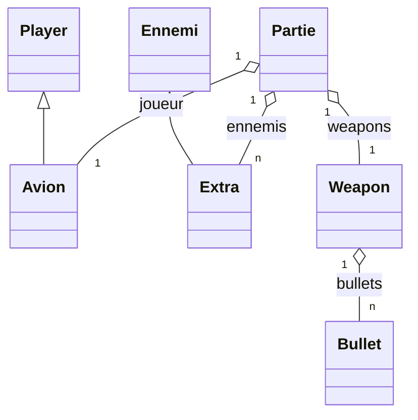

STRUCTURE ET DEROULEMENT DU JEU

Objets (classes) :

| Classe | Fichier | Role | Attributs | Methodes |
| --- | --- | --- | --- | --- |
| Player | classes/player.py | base d'un joueur | x, y, speed, direction, vy, limite_droite | move(direction) |
| Avion (herite de Player) | classes/player.py | joueur affiche a l'ecran | images (9 images), playerImg | changer_image(vies, direction), afficher(screen) |
| Ennemi | classes/ennemi.py | base d'un ennemi | enemyX, enemyY, speed, speed_down, limites, dh, dv | move() |
| Extra (herite de Ennemi) | classes/ennemi.py | ennemi affiche a l'ecran | enemyImg, hitbox | afficher(screen) |
| Bullet | classes/arme.py | une balle | x, y, speed, state (ready / fire), hitbox | fire(x, y), update() |
| Weapon | classes/arme.py | gere les tirs | bullets (liste), last_shot, shoot_delay | shoot_continuous(x, y), create_2_bullets(x, y), update() |
| Sons | end/audio.py | musique + bruitages | explosion, hit, game_over | stopper_musique() |
| Partie | jeu.py | etat d'une partie | background, joueur, vies, score, timers, weapons, ennemis | (aucune pour l'instant) |

Relations :

- Partie contient 1 Avion, 1 Weapon et une liste d'Extra
- Weapon contient une liste de Bullet
- Sons est cree a part dans le main

Fichiers :

- main.py : demarrage + boucle de jeu
- jeu.py : classe Partie
- classes/ : player.py, ennemi.py, arme.py
- end/init.py : taille ecran, limites, creation du fond / joueur / ennemi / vies / score
- end/affichage.py : afficher_score, afficher_vie, game_over
- end/physique.py : collision_bullets_ennemies, collision_ennemi_bas
- end/audio.py : classe Sons
- asset_paths.py : chemins des images et des sons

Constante :

- ecran : 1280 x 800, 60 images par seconde
- joueur : 150 x 150 pixels, vitesse 8, 3 vies
- ennemi : 80 x 80 pixels, vitesse 5, descente 1, apparition toutes les 500 ms
- balle : vitesse 10, 2 balles par tir, 1 tir toutes les 600 ms
- score : +1 toutes les 50 ms, +50 par ennemi detruit
- "+50" affiche pendant 1000 ms
- fond : defile de 2 pixels par image
- game over : ecran affiche 3000 ms

Variable :

- dt (temps ecoule depuis la derniere image)
- direction du joueur (-1, 0, 1)
- vies, score
- timers : spawn_timer, score_timer, bonus_timer
- position du fond (background_y1, background_y2)
- listes : ennemis, bullets

Deroulement :

1. Demarrage
    - pygame.init() + creation de la fenetre
    - creation de Sons (la musique demarre)
    - creation de Partie (fond, joueur, vies, score, arme, 1er ennemi)

2. Boucle de jeu (a chaque image)
    1. lire dt et les evenements (fermer la fenetre = fin)
    2. score +1 si 50 ms ecoulees
    3. faire defiler et afficher le fond
    4. afficher le joueur
    5. si 500 ms ecoulees : ajouter un ennemi
    6. afficher et deplacer chaque ennemi
    7. afficher le score
    8. lire le clavier : gauche / droite = deplacer le joueur, espace = tirer
    9. collision balle - ennemi : les deux disparaissent, score +50, afficher "+50"
    10. collision ennemi - bas de l'ecran : l'ennemi disparait, -1 vie
    11. choisir l'image de l'avion selon vies et direction
    12. afficher la barre de vie
    13. si vies <= 0 : Game Over (voir 3)
    14. deplacer et afficher les balles
    15. mettre l'ecran a jour

3. Game Over
    - couper la musique + bruitage game over
    - afficher "GAME OVER" + score pendant 3 secondes
    - quitter le jeu

Etat de l'avion :

- 3 vies : normal
- 2 vies : damaged
- 1 vie : critical
- chaque etat a 3 images : droit, penche a gauche, penche a droite
