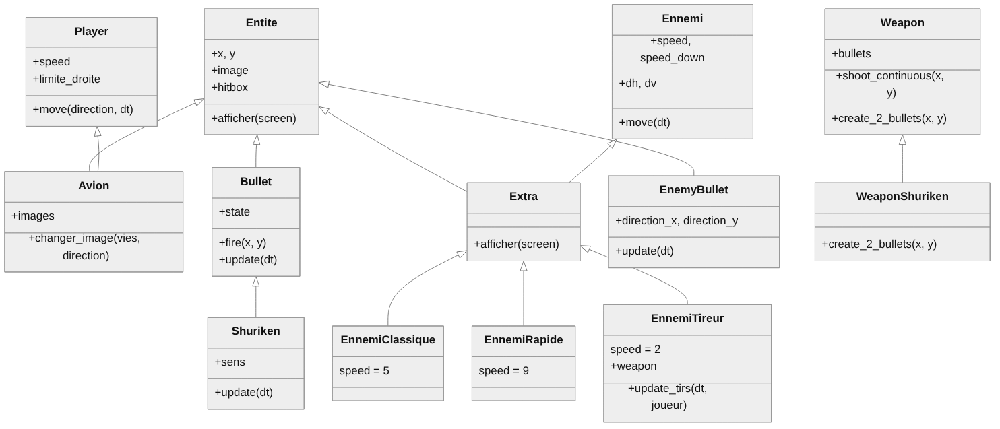
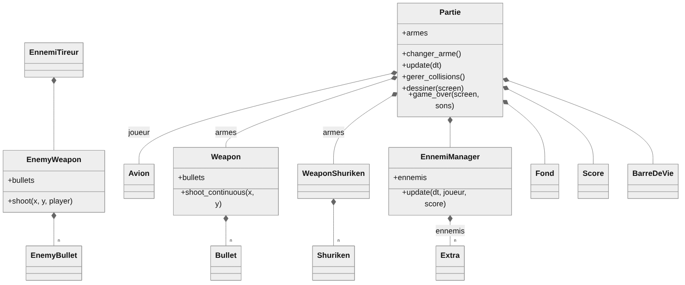

# Space Invaders — Rapport de conception

**Luka Parmentier** et **Roméo** — UE43 Programmation, HELMo A2 — novembre 2026

**Dépôt GitHub :** <https://github.com/Brukzer/Space-invander>

---

## 1. Analyse du programme initial

Le programme de départ est un script procédural de 193 lignes réparties en six fichiers, mais ce découpage est trompeur : les fichiers ne s'importent pas entre eux et partagent un espace de noms global unique. Toute la logique tient dans une boucle `while` de 80 lignes.

**L'état du jeu est global et dispersé.** `playerX`, `bulletY`, `bullet_state`, `score_value` sont des variables modifiables depuis n'importe quel point du programme. Aucun objet ne possède ses propres données, donc rien ne garantit la cohérence : `fire_bullet()` modifie `bullet_state` via `global`, et la boucle la relit vingt lignes plus loin.

**Les entités sont représentées par des listes parallèles.** Un ennemi n'existe pas en tant qu'objet : il est éparpillé sur cinq listes indexées par le même `i`.

```python
enemyImg, enemyX, enemyY = [], [], []
enemyX_change, enemyY_change = [], []
num_of_enemies = 6
```

Ajouter un attribut — des points de vie, par exemple — impose de créer une sixième liste et de modifier chaque boucle qui itère sur les ennemis. Le nombre d'ennemis est figé à six, et un ennemi « détruit » n'est pas supprimé mais repositionné au hasard, ce qui rend impossible toute notion de flotte variable.

**Aucune abstraction ne permet la variation.** Il n'existe qu'une seule balle, représentée par les variables `bulletX`, `bulletY` et `bullet_state` : le joueur ne peut pas tirer tant que la précédente n'a pas quitté l'écran. Créer un second type d'ennemi ou une seconde arme supposerait de dupliquer tout le jeu de variables et toutes les boucles associées.

**Logique et affichage sont confondus.** La fonction `fire_bullet()` change l'état de la balle *et* la dessine dans le même appel. Il est donc impossible de calculer une image de jeu sans l'afficher, donc impossible de tester quoi que ce soit sans ouvrir une fenêtre.

**Les valeurs sont écrites en dur et la vitesse dépend de la machine.** Les nombres `736`, `480`, `440` et `27` encodent implicitement une fenêtre de 800 × 600. Surtout, aucune limite d'images par seconde n'est fixée et les déplacements s'expriment en pixels par image : le jeu tourne deux fois plus vite sur un ordinateur deux fois plus rapide.

**Conséquence.** Chacune de ces limites conduit au même résultat : la moindre évolution oblige à rouvrir la boucle principale et à y insérer du code, qui s'ajoute à celui déjà présent. Le coût d'un ajout croît avec la taille de ce qui existe déjà.

---

## 2. Architecture proposée

Le projet est réparti en cinq dossiers aux responsabilités distinctes.

| Dossier | Rôle |
| --- | --- |
| `classes/` | Les objets du jeu : vaisseau, ennemis, projectiles, armes, score, barre de vie, fond |
| `backend/` | La logique : état d'une partie, chargement des ressources, collisions, lecture du clavier, son |
| `frontend/` | L'affichage dépendant de l'écran de fin |
| `config/` | Les constantes et les chemins des ressources |
| `assets/` | Les assets : image, sons |

`main.py` se limite à créer la fenêtre et à dérouler la boucle de jeu sous forme d'appel.

### 2.1 Hiérarchie d'héritage



### 2.2 Relations de composition



---

## 3. Justification des choix

**Des classes choisies pour faciliter les implémentations.** Chaque élément du jeu est une classe qui regroupe ses caractéristiques et son affichage : pour modifier ou ajouter un élément, on sait quelle classe ouvrir, et tout ce qui le concerne s'y trouve. Ce regroupement est un choix assumé : séparer strictement l'affichage de chaque objet aurait doublé le nombre de classes sans rien apporter à un jeu de cette taille. Trois classes servent de points d'extension — `Entite` pour tout ce qui s'affiche, `Extra` pour tout ennemi, `Weapon` pour toute arme — et un nouvel élément s'obtient par héritage, en ne redéfinissant que ce qui le distingue. La seconde arme du joueur en est la preuve : `WeaponShuriken` tient en six lignes et ne redéfinit qu'une méthode.

**Une arborescence organisée de manière claire.** Le nom du dossier donne le rôle, le nom du fichier donne l'objet :

```text
GAME/
  main.py        point d'entrée : fenêtre et boucle de jeu
  classes/       un fichier par objet du jeu : player, ennemi, arme, score, fond, barre de vie
  backend/       logique : partie, initialisation, collisions, clavier, sons
  frontend/      affichage qui ne dépend d'aucun objet : écran de fin
  config/        constantes du jeu et chemins des ressources
  assets/        images et sons, rangés par type
  doc/           phases préparatoires, roadmap, rapport
```

Chaque modification a ainsi une adresse évidente : régler une vitesse se fait dans `config/config.py`, ajouter un ennemi dans `classes/ennemi.py`, changer une image dans `assets/`. Un autre groupe peut reprendre le projet sans lire tout le code.

**`Entite` comme racine de tout ce qui s'affiche.** Le vaisseau, les ennemis et les projectiles partagent une position, une image, une boîte de collision et un comportement : se dessiner. Les rassembler dans une classe mère évite de réécrire le même `afficher()` dans chaque classe et garantit que tout objet possède une hitbox, condition nécessaire aux collisions.

**Séparer le déplacement de l'affichage par héritage multiple.** `Player` décrit comment un vaisseau se déplace, `Ennemi` comment un ennemi patrouille et descend ; ni l'un ni l'autre ne sait s'afficher. `Avion` et `Extra` combinent chacun une logique de déplacement avec `Entite` :

```python
class Extra(Ennemi, Entite):
    def __init__(self, x, y, limite_gauche, limite_droite, limite_bas, enemyImg, dh, dv):
        Ennemi.__init__(self, x, y, 5, 1, limite_gauche, limite_droite, limite_bas, dh, dv)
        Entite.__init__(self, x, y, enemyImg)
```

Les deux axes varient ainsi indépendamment : un nouvel ennemi change sa façon de bouger sans toucher à son affichage.

**`Partie` regroupe l'état du jeu.** Plutôt que de laisser la boucle manipuler une douzaine de variables, `Partie` compose les objets du jeu — joueur, armes, ennemis, score, barre de vie, fond — et prend en charge leur mise à jour, les collisions et l'affichage. C'est la composition, et non l'héritage, qui convient ici : une partie n'*est* pas un score, elle *possède* un score.

**Un gestionnaire dédié aux ennemis.** `EnnemiManager` concentre l'apparition, le déplacement et les tirs de la flotte. Sans lui, ces responsabilités seraient retombées dans `Partie`, qui serait redevenue le fourre-tout que la boucle initiale était déjà. Il permet aussi de faire dépendre la composition de la flotte du score, règle de difficulté qui n'a sa place ni dans `Partie` ni dans les classes d'ennemis.

**Des fonctions, et non des classes, pour ce qui n'a pas d'état.** `physique.py` et `controle.py` contiennent des fonctions libres. Une collision est un calcul sans mémoire, la lecture du clavier interroge un périphérique unique : aucun des deux n'a de données à conserver entre deux appels.

**Des constantes centralisées.** `config/config.py` rassemble dimensions, vitesses, délais et couleurs. La constante `REFERENCE_FRAME` — la durée d'une image à 60 images par seconde — sert de référence à tous les déplacements, qui s'expriment en `vitesse × (dt / REFERENCE_FRAME)` : la vitesse à l'écran est identique quelle que soit la machine.

---

## 4. Extensibilité

Ajouter un élément suit toujours la même démarche : une classe qui hérite, une image, une ligne pour l'enregistrer. Le reste du programme ne change pas.

### 4.1 Ajouter une arme

La seconde arme du joueur, qui lance des shurikens en courbe, a été ajoutée de cette façon.

1. **Le projectile**, s'il se déplace autrement qu'une balle : une classe qui hérite de `Bullet` et redéfinit `update()`. La montée reste celle de `Bullet`, seule la courbe est ajoutée.
2. **L'arme** : une classe qui hérite de `Weapon` et redéfinit la création des projectiles.
3. **L'image**, chargée une seule fois dans `charger_images()`.
4. **L'enregistrement** : une entrée dans la liste des armes de `Partie`.

```python
class Shuriken(Bullet):
    def update(self, dt):
        super().update(dt)                                   # la montée est celle de Bullet
        distance = self.y_depart - self.y
        self.x = self.x_depart + self.sens * SHURIKEN_AMPLITUDE * math.sin(distance / SHURIKEN_LONGUEUR)
        self.hitbox.x = self.x

class WeaponShuriken(Weapon):
    def create_2_bullets(self, x, y):
        for sens in (-1, 1):                                 # deux shurikens qui se croisent
            shuriken = Shuriken(self.bullet_image, sens)
            shuriken.fire(x + 45 - shuriken.hitbox.width // 2, y)
            self.bullets.append(shuriken)
```

```python
self.armes = [Weapon(self.bullet_images), WeaponShuriken(self.shuriken_image)]   # dans Partie
```

Le délai entre deux tirs, la suppression des projectiles sortis de l'écran, l'affichage et les collisions sont hérités de `Weapon` : rien n'a été réécrit. `Partie` parcourt la liste `armes` pour les mettre à jour, et la flèche du haut passe à l'arme suivante de cette liste. Une troisième arme entre donc dans la rotation sans autre modification.

### 4.2 Ajouter un ennemi

1. **La classe**, dans `classes/ennemi.py` : elle hérite de `Extra` et ne change que ce qui la distingue.
2. **L'image**, ajoutée au dictionnaire `enemy_images` de `charger_images()`.
3. **L'enregistrement**, dans `init_ennemy()` : le nom du type dans le dictionnaire `classes_ennemis`, et son poids dans le tirage au sort selon le score.

```python
class EnnemiRapide(Extra):
    def __init__(self, x, y, limite_gauche, limite_droite, limite_bas, enemyImg, dh, dv):
        super().__init__(x, y, limite_gauche, limite_droite, limite_bas, enemyImg, dh, dv)
        self.speed = 9
```

`EnnemiManager` déplace et affiche tous les ennemis de sa liste sans connaître leur type : aucune de ses lignes ne change, pas plus que les collisions. Un ennemi peut aussi recevoir un comportement par composition : `EnnemiTireur` possède sa propre arme, `EnemyWeapon`, qui tire vers la position du joueur.

### 4.3 Ajouter un style de joueur

Un nouveau vaisseau reprend la même démarche. Par exemple, un chasseur plus rapide :

1. **Les images** : un dictionnaire sur le modèle de `images_avion`, soit trois états (normal, endommagé, critique) fois trois inclinaisons.
2. **La classe**, dans `classes/player.py` : elle hérite de `Avion` et modifie ses caractéristiques.
3. **La création**, dans `init_player()`, qui charge ces images et instancie la classe choisie.

```python
class Chasseur(Avion):
    def __init__(self, x, y, direction, vy, limite_droite, images):
        super().__init__(x, y, direction, vy, limite_droite, images)
        self.speed = 12
```

Le déplacement et ses limites viennent de `Player`, le changement d'image selon les vies et l'inclinaison vient de `Avion`, l'affichage et la hitbox viennent de `Entite`. Le reste du jeu manipule un joueur sans savoir de quel vaisseau il s'agit.

### 4.4 Modifier l'équilibrage

Changer la cadence de tir, la vitesse des ennemis, la courbe des shurikens ou les points par ennemi détruit se fait dans `config/config.py`, sans ouvrir une seule classe.
